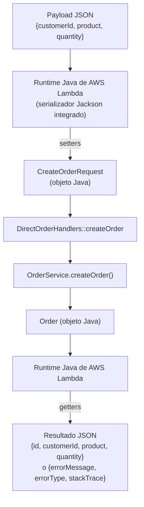
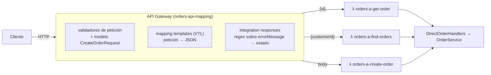
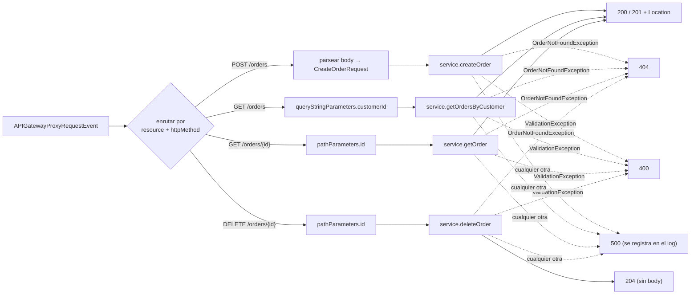
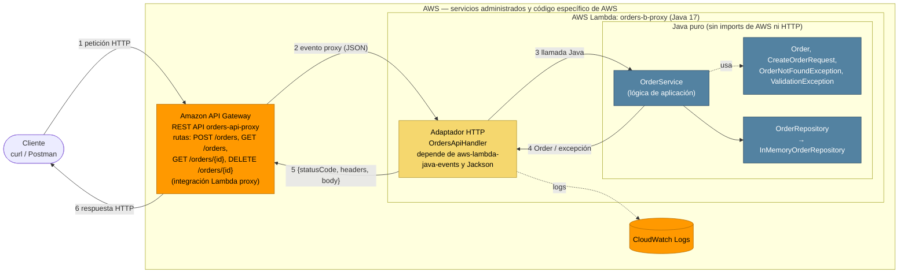

# Orders API — API REST serverless con AWS Lambda y API Gateway

Una pequeña API de gestión de pedidos en **Java 17 + Maven**, expuesta mediante **Amazon API
Gateway** con dos arquitecturas que comparten la misma lógica de aplicación en Java puro:

* **A — Mapping templates (integración sin proxy).** API Gateway extrae los parámetros, arma el
  JSON que recibe Lambda y convierte los errores en códigos de estado. Hay una Lambda por operación.
* **B — Integración Lambda proxy.** API Gateway reenvía la petición HTTP completa a una sola Lambda,
  y un adaptador HTTP delgado en Java se encarga del enrutamiento y de las respuestas HTTP.

| Operación | Petición | Éxito |
|---|---|---|
| Crear un pedido | `POST /orders` | `201 Created` + `Location` |
| Consultar un pedido | `GET /orders/{id}` | `200 OK` |
| Buscar pedidos de un cliente | `GET /orders?customerId={customerId}` | `200 OK` |
| Eliminar un pedido *(reto final, arquitectura B)* | `DELETE /orders/{id}` | `204 No Content` |

---

## Contenido

1. [Compilar y probar](#1-compilar-y-probar)
2. [Estructura del proyecto](#2-estructura-del-proyecto)
3. [Diseño de la API (contrato)](#3-diseño-de-la-api-contrato)
4. [Checkpoint 1 — Java puro](#4-checkpoint-1--java-puro)
5. [Parte II — Lambda y la conversión JSON ↔ Java](#5-parte-ii--lambda-y-la-conversión-json--java)
6. [Arquitectura A — mapping templates de API Gateway](#6-arquitectura-a--mapping-templates-de-api-gateway)
7. [Arquitectura B — integración Lambda proxy](#7-arquitectura-b--integración-lambda-proxy)
8. [Comparación de las dos arquitecturas](#8-comparación-de-las-dos-arquitecturas)
9. [Errores internos inesperados](#9-errores-internos-inesperados)
10. [Arquitectura final](#10-arquitectura-final)
11. [Desarrollo asistido por IA — crítica al agente](#11-desarrollo-asistido-por-ia--crítica-al-agente)
12. [Reto final — DELETE](#12-reto-final--delete)
13. [Checklist de la demostración](#13-checklist-de-la-demostración)

Otros documentos:

* [`docs/aws-setup.md`](docs/aws-setup.md): cómo reproducir la configuración de AWS, con SAM o paso a paso en la consola.
* [`docs/examples.md`](docs/examples.md): ejemplos de peticiones y respuestas (curl).
* [`docs/delete-prediction.md`](docs/delete-prediction.md): predicción del reto DELETE y su resultado.
* [`template.yaml`](template.yaml): infraestructura como código de ambas arquitecturas, con todos los mapping templates.
* [`events/`](events/): payloads de ejemplo. `direct-*.json` sirven para invocar las Lambdas directamente; `proxy-*.json` son eventos proxy de API Gateway.

---

## 1. Compilar y probar

Requisitos: JDK 17 o superior, Maven 3.9+.

```bash
mvn test        # pruebas unitarias: sin cuenta de AWS, sin red, sin servidor
mvn package     # target/orders-api-1.0.0.jar  (JAR "shaded" que se sube a Lambda)
```

El despliegue está en [`docs/aws-setup.md`](docs/aws-setup.md). En resumen:
`mvn package && sam deploy --guided`.

---

## 2. Estructura del proyecto

```
.
├── pom.xml
├── template.yaml                     # SAM: ambas APIs, todas las Lambdas, mapping templates
├── events/                           # entradas de ejemplo para Lambda (directas y proxy)
├── docs/
└── src/
    ├── main/java/edu/eci/tdse/orders/
    │   ├── domain/                   # ── Java puro, sin AWS ni HTTP ──
    │   │   ├── Order.java
    │   │   ├── CreateOrderRequest.java
    │   │   ├── OrderService.java     # crear / consultar / buscar por cliente / eliminar
    │   │   ├── OrderRepository.java  # interfaz de almacenamiento
    │   │   ├── InMemoryOrderRepository.java
    │   │   ├── OrdersApplication.java# armado del servicio + datos de ejemplo
    │   │   ├── OrderException.java   # base: lleva un código de error de negocio
    │   │   ├── OrderNotFoundException.java
    │   │   └── ValidationException.java
    │   └── lambda/
    │       ├── direct/               # handlers de la arquitectura A (POJO entra / POJO sale, sin librerías AWS)
    │       │   ├── DirectOrderHandlers.java
    │       │   ├── DirectInvocationException.java
    │       │   ├── OrderIdInput.java
    │       │   └── CustomerQueryInput.java
    │       └── proxy/                # adaptador HTTP de la arquitectura B (conoce API Gateway y HTTP)
    │           ├── OrdersApiHandler.java
    │           └── ErrorResponse.java
    └── test/java/edu/eci/tdse/orders/
        ├── ArchitectureTest.java     # falla si domain/ importa AWS, Jackson, servlets, Spring…
        ├── domain/OrderServiceTest.java
        ├── lambda/direct/DirectOrderHandlersTest.java
        └── lambda/proxy/OrdersApiHandlerTest.java
```

---

## 3. Diseño de la API (contrato)

El contrato se escribió antes que cualquier línea de código.

### Representaciones

```json
// Pedido
{ "id": "ORD-001", "customerId": "CUST-42", "product": "MacBook Air", "quantity": 1 }

// Error (todas las respuestas de error, sin importar qué componente las genere)
{ "error": "ORDER_NOT_FOUND", "message": "Order ORD-999 does not exist" }
```

`error` es un código estable que el cliente puede usar en su lógica, y `message` es una
explicación legible para personas. El estado HTTP no se repite en el body porque ya viene en la
línea de estado.

| Código `error` | HTTP | Significado |
|---|---|---|
| `VALIDATION_ERROR` | 400 | Falta un campo o parámetro obligatorio, o se viola una regla de negocio |
| `INVALID_REQUEST_BODY` | 400 | El body no es JSON válido o tiene tipos incorrectos (B) |
| `ORDER_NOT_FOUND` | 404 | No existe un pedido con ese id |
| `ROUTE_NOT_FOUND` | 404 | No existe ese recurso o método |
| `METHOD_NOT_ALLOWED` | 405 | El recurso existe pero no con ese método (B, con header `Allow`) |
| `INTERNAL_ERROR` | 500 | Falla inesperada. El detalle va al log, nunca a la respuesta |

### Operaciones

| | `POST /orders` | `GET /orders/{id}` | `GET /orders?customerId=` | `DELETE /orders/{id}` |
|---|---|---|---|---|
| Parámetros de ruta | – | `id` (id del pedido) | – | `id` |
| Parámetros de query | – | – | `customerId` (**obligatorio**) | – |
| Body de la petición | `{"customerId","product","quantity"}` | – | – | – |
| Éxito | **201** + `Location: /orders/{nuevoId}` + el `Order` creado | **200** + `Order` | **200** + `Order[]` (puede ser `[]`) | **204**, sin body |
| Errores | 400 `VALIDATION_ERROR` / `INVALID_REQUEST_BODY`, 500 | 400 (id vacío), 404 `ORDER_NOT_FOUND`, 500 | 400 (falta `customerId`), 500 | 404 `ORDER_NOT_FOUND`, 500 |

Reglas de validación: `customerId` y `product` son obligatorios y no pueden estar vacíos;
`quantity` es un entero obligatorio ≥ 1. El `id` siempre lo asigna el servidor, así que si el
body del POST trae un `id`, se ignora.

### Preguntas

**¿Cuáles son los recursos de la API?**
Hay dos: la colección de pedidos, `/orders`, y cada pedido individual, `/orders/{id}`. El cliente
no es un recurso en esta API; es solo un atributo por el que se filtra (ver más abajo).

**¿Por qué `/orders/{id}` para consultar un pedido?**
En REST, una URL identifica un recurso. El id es lo que distingue un pedido de los demás, así que
va en la ruta, como hijo de la colección a la que pertenece. `GET` sobre esa URL lo lee, `DELETE`
sobre la misma URL lo elimina, y `POST /orders` devuelve esa URL en `Location`. La URL es
estable, se puede cachear y guardar, y no contiene verbos (`/getOrder?id=` sería estilo RPC).

**¿Por qué `customerId` es un parámetro de query en la búsqueda?**
La búsqueda no identifica un recurso nuevo; filtra la colección `/orders`. El resultado siguen
siendo "pedidos", solo que menos. Los parámetros de query son el lugar convencional para filtros
opcionales y combinables (`?customerId=…&product=…&page=2`). Un diseño como
`/customers/{id}/orders` tendría sentido solo si los clientes fueran recursos de primera clase en
esta API, y no lo son.

**¿Qué debe devolver `POST /orders` cuando el pedido se crea correctamente?**
`201 Created`, un header `Location: /orders/{id}` que apunta al nuevo recurso y el pedido creado
(con el `id` generado por el servidor) en el body. Así el cliente no necesita otra petición para
conocer el id.

**¿Qué debe devolver la API cuando un pedido no existe?**
`404 Not Found` con `{"error":"ORDER_NOT_FOUND","message":"Order ORD-999 does not exist"}`.
Esto es distinto de una búsqueda sin resultados: `GET /orders?customerId=CUST-NOBODY` devuelve
`200` y `[]`, porque la colección existe y la vista filtrada simplemente está vacía.

**¿Qué información debe contener una respuesta de error?**
Un código estable (`error`) y un `message` legible. No debe incluir stack traces, nombres de
clases de excepción ni otros detalles internos. El formato es el mismo para todos los errores,
los genere Java o API Gateway. En un sistema más grande agregaría también un id de petición o de
correlación (el `awsRequestId` de Lambda) para relacionar el reporte de un cliente con los logs.

---

## 4. Checkpoint 1 — Java puro

`OrderService` expone `createOrder(CreateOrderRequest)`, `getOrder(String)` y
`getOrdersByCustomer(String)`. Reporta las fallas con `OrderNotFoundException` y
`ValidationException`, cada una con un código de negocio. No aparece ningún estado HTTP.

| Pregunta | Respuesta |
|---|---|
| ¿Se puede probar la funcionalidad sin AWS? | **Sí.** `OrderServiceTest` cubre la creación de un pedido válido, la consulta de uno existente, un pedido inexistente, la búsqueda por cliente y entradas inválidas. Solo necesita la JVM y JUnit. |
| ¿Requiere un servidor web? | **No.** Nada escucha en un puerto; son llamadas normales a métodos Java. |
| ¿Requiere Spring Boot? | **No.** No hay ningún framework. `ArchitectureTest` hace fallar el build si `domain/` importa Spring, servlets, AWS o Jackson. |
| ¿Qué contiene el JAR generado? | `mvn package` usa el plugin Shade. `target/orders-api-1.0.0.jar` (≈3.4 MB) trae nuestras clases compiladas y todas las dependencias de ejecución: `aws-lambda-java-core`, `aws-lambda-java-events` y Jackson. Lambda necesita este único "uber JAR". `original-orders-api-1.0.0.jar` (≈20 KB) contiene solo nuestras clases. |
| ¿Qué partes conocen HTTP hasta ahora? | **Ninguna parte de la lógica de aplicación.** Solo `lambda/proxy/OrdersApiHandler` (arquitectura B) conoce métodos HTTP, códigos de estado y headers. En la arquitectura A, el conocimiento HTTP vive en la configuración de API Gateway, no en Java. |

---

## 5. Parte II — Lambda y la conversión JSON ↔ Java

`DirectOrderHandlers::createOrder` se despliega como la función `orders-a-create-order` y se
invoca directamente con `events/direct-create-order.json` y `events/direct-create-order-2.json`.
Los pasos están en [`docs/aws-setup.md`](docs/aws-setup.md#part-ii--a-lambda-invoked-directly-no-api-gateway).

`DirectOrderHandlers` **no** implementa `RequestHandler` y no importa nada de AWS. Es una clase
normal con métodos como `Order createOrder(CreateOrderRequest)`.

### ¿Cómo convierte el runtime de Java de Lambda el JSON en objetos Java y viceversa?

1. **El string del handler elige el método.** El valor
   `edu.eci.tdse.orders.lambda.direct.DirectOrderHandlers::createOrder` le indica al runtime qué
   clase instanciar y qué método llamar. La clase necesita un constructor público sin argumentos,
   y la instancia se reutiliza mientras el entorno de ejecución siga "caliente". No hace falta
   implementar `RequestHandler`, porque el runtime encuentra el método por reflexión. Se puede
   agregar un parámetro `Context` como segundo argumento.
2. **Entrada.** El runtime mira el tipo del parámetro del método y deserializa el payload en ese
   tipo con su serializador integrado (la librería `aws-lambda-java-serialization`, un Jackson
   empaquetado internamente):
   * POJO: se crea con el constructor sin argumentos y las propiedades del JSON se asignan con los
     setters correspondientes (`"customerId"` → `setCustomerId`).
   * Las propiedades que faltan en el JSON quedan en `null` o en su valor por defecto. Por eso
     `quantity` es `Integer`: así se distingue "no vino" de `0`.
   * Las propiedades del JSON que no tienen setter se ignoran.
   * También se soportan `String`, `Integer`, `Map`, `List` y las clases de eventos de AWS
     (`APIGatewayProxyRequestEvent`…), que tienen reglas de mapeo especiales.
   * Si el handler recibe `InputStream`/`OutputStream` (`RequestStreamHandler`), **no** hay
     conversión y uno mismo parsea los bytes.
3. **Salida.** El valor de retorno se serializa a JSON a través de sus **getters**
   (`getId()` → `"id"`). `void`/`null` producen `null`. Por eso `Order` es una clase con getters
   y no un record: los records exponen `id()` en lugar de `getId()`, y solo las versiones recientes
   del serializador del runtime los entienden.
4. **Excepciones.** Una excepción no capturada se convierte en un documento JSON de error
   `{"errorMessage": "...", "errorType": "<clase de la excepción>", "stackTrace": [...]}`, y la
   invocación queda marcada como *function error*. La arquitectura A depende de esto, porque API
   Gateway aplica sus regex sobre `errorMessage`.

### Verificación contra la Lambda desplegada

La explicación anterior vino del LLM. Ejecuta estas invocaciones, compáralas con la columna
"Esperado" y anota lo que realmente observaste:

| Entrada | Esperado (según la explicación) | Observado |
|---|---|---|
| `direct-create-order.json` | `{"id":"ORD-XXXXXXXX","customerId":"CUST-42","product":"MacBook Air","quantity":1}` | |
| `direct-create-order-2.json` | id nuevo, `CUST-100`, `quantity: 3` | |
| `{"customerId":"CUST-42","product":"Mouse","quantity":1,"color":"red"}` | funciona, `color` se ignora | |
| `{"customerId":"CUST-42","product":"Mouse"}` | error, `errorMessage: "VALIDATION_ERROR: quantity is required"` (lo que falta → `null`) | |
| `{"customerId":"CUST-42","product":"Mouse","quantity":"2"}` | funciona, `"2"` se convierte en `2` | |
| `direct-create-order-invalid.json` | `errorMessage: "VALIDATION_ERROR: quantity must be greater than 0"`, `errorType: ...DirectInvocationException` | |
| invocar `orders-a-get-order` con `direct-get-order-missing.json` | `errorMessage: "ORDER_NOT_FOUND: Order ORD-999 does not exist"` | |

### Checkpoint 2 — el flujo real



---

## 6. Arquitectura A — mapping templates de API Gateway



### `GET /orders/{id}`

El request template extrae `{id}` de la ruta:

```velocity
{"id": "$util.escapeJavaScript($input.params('id'))"}
```

así que `GET /orders/ORD-42` invoca `getOrder` con `{"id": "ORD-42"}`. El código Java nunca ve
la URL.

### `GET /orders?customerId=…`

`customerId` se declara como parámetro de query obligatorio, y el validador de peticiones
devuelve `400` antes de llamar a Lambda si falta. El template:

```velocity
{"customerId": "$util.escapeJavaScript($input.params('customerId'))"}
```

### `POST /orders`

API Gateway valida el body contra el modelo JSON Schema `CreateOrderRequest`, que solo revisa
campos obligatorios y tipos. Después el body pasa tal cual (`$input.json('$')`). La integration
response por defecto se cambia a **201**, y un template agrega el header `Location`:

```velocity
#set($context.responseOverride.header.Location = "/orders/$input.path('$.id')")
$input.json('$')
```

### Semántica HTTP: cómo los errores se vuelven códigos de estado

El handler Java señala los errores lanzando `DirectInvocationException` con el mensaje
`"<CODIGO>: <texto>"`. API Gateway aplica **Lambda error regexes** sobre `errorMessage`:

| Regex | Estado | Body generado por el template |
|---|---|---|
| *(por defecto)* | 200 / 201 | el resultado de la Lambda |
| `ORDER_NOT_FOUND:.*` | 404 | `{"error":"ORDER_NOT_FOUND","message":"Order ORD-999 does not exist"}` |
| `VALIDATION_ERROR:.*` | 400 | `{"error":"VALIDATION_ERROR","message":"quantity must be greater than 0"}` |
| `INTERNAL_ERROR:.*` | 500 | `{"error":"INTERNAL_ERROR","message":"Unexpected internal error"}` |

Los errores propios de API Gateway (body inválido, parámetro faltante, ruta desconocida) usan el
mismo formato JSON gracias a las **gateway responses**. La configuración completa está en
`template.yaml` (`MappedApi`) y en
[`docs/aws-setup.md`](docs/aws-setup.md#part-iv--architecture-a-rest-api-with-mapping-templates).

### Checkpoint 3 — de qué se encarga API Gateway en A

| Responsabilidad | Dónde vive en A |
|---|---|
| Enrutamiento (método + ruta → función) | API Gateway: cada método está conectado a su propia Lambda |
| Extraer parámetros de ruta | Mapping template de API Gateway (`$input.params('id')`) |
| Extraer parámetros de query | Mapping template + declaración de parámetro obligatorio |
| Validación estructural (campos obligatorios, tipos) | Validador de peticiones + modelo de API Gateway |
| Validación de negocio (`quantity ≥ 1`, no vacíos) | Java (`OrderService`) |
| Transformar peticiones | API Gateway (VTL arma la entrada de la Lambda) |
| Transformar respuestas | API Gateway (VTL arma el body de error y agrega `Location`) |
| Elegir códigos de estado | API Gateway (respuesta por defecto = 200/201, regex = 4xx/5xx) |
| Mapear errores | **Compartido.** Java decide el *código* (`ORDER_NOT_FOUND`); API Gateway lo convierte en estado y body |

**Ventajas**

* Los handlers Java son mínimos: sin HTTP y sin imports de AWS; cada uno es solo una llamada a
  un método.
* Las peticiones inválidas se rechazan *antes* de ejecutar una Lambda, lo que ahorra
  invocaciones y cold starts.
* El contrato de la API (parámetros, modelos, códigos de estado) se declara en un solo lugar que
  se puede exportar como OpenAPI/Swagger.
* Cada operación es su propia función, así que puede tener su propia memoria, timeout, permisos
  IAM y métricas.

**Desventajas**

* **El comportamiento queda repartido en dos lugares unidos por strings.** El prefijo
  `"ORDER_NOT_FOUND: "` en Java tiene que coincidir con una regex en API Gateway. Si alguien
  renombra el código en Java, el compilador y las pruebas unitarias pasan, y la API empieza a
  responder **200** con un body de error.
* **Las fallas que no coinciden con ninguna regex caen en la respuesta por defecto.** Eso es un
  200 (o 201) con `{"errorMessage": ...}`. Un timeout o un out-of-memory de Lambda produce un
  mensaje sin nuestro prefijo, así que termina exactamente en este caso.
* VTL es difícil de leer, depurar y probar, y nada de eso corre en `mvn test`. Un error de
  tipeo solo aparece después de desplegar.
* La configuración crece con cada operación × cada código de estado.
* Dependencia del proveedor: el comportamiento HTTP existe solo en la configuración propietaria
  de API Gateway.
* En este taller, cada función tiene su propio almacenamiento en memoria, así que **un pedido
  creado con el POST de A no se puede leer con el GET de A**: son JVMs distintas. Solo los
  pedidos precargados son visibles en todas las funciones. (B tiene el mismo problema entre cold
  starts e instancias concurrentes; ninguno de los dos almacenamientos es persistente.)

---

## 7. Arquitectura B — integración Lambda proxy

Con la integración proxy, API Gateway no transforma nada: envuelve la petición HTTP completa en
un evento, y la Lambda debe devolver `{statusCode, headers, body}`.

### Dónde aparece cada dato en el evento proxy

Ejemplo: [`events/proxy-get-order.json`](events/proxy-get-order.json); también `proxy-find-orders.json` y `proxy-create-order.json`.

| Información | Campo del evento (REST API, payload v1) | Ejemplo |
|---|---|---|
| Método HTTP | `httpMethod` (también `requestContext.httpMethod`) | `"GET"` |
| Ruta | `path` (real) / `resource` (plantilla) | `"/orders/ORD-42"` / `"/orders/{id}"` |
| Parámetros de ruta | `pathParameters` | `{"id": "ORD-42"}` |
| Parámetros de query | `queryStringParameters` (+ `multiValueQueryStringParameters`) | `{"customerId": "CUST-42"}` |
| Headers | `headers` (+ `multiValueHeaders`) | `{"Content-Type": "application/json", ...}` |
| Body de la petición | `body`: siempre un **string** (el JSON no viene parseado); ver `isBase64Encoded` | `"{\"customerId\":\"CUST-42\",...}"` |

Cuando un campo no está, llega como `null`, no vacío. Por ejemplo, `queryStringParameters` es
`null` si no hay query string, y el handler lo maneja. Con `LOG_EVENTS=true` en la función se
imprimen los eventos reales en CloudWatch.

### El adaptador HTTP

`OrdersApiHandler` es la **única** clase que conoce API Gateway y HTTP:



* El handler conoce el evento, el enrutamiento, los parámetros de ruta y query, el parseo JSON
  del body, los códigos de estado, los headers `Content-Type`, `Location` y `Allow`, y la
  serialización de la respuesta.
* La lógica de aplicación sigue trabajando solo con `Order`, `CreateOrderRequest`, ids de cliente
  y cantidades, igual que antes. **No cambió ninguna clase de `domain/`** para soportar B.

En el 201 se devuelve `Location: /orders/{id}`, que es la forma estándar (RFC 9110) de indicarle
al cliente la URL del recurso que acaba de crear. Es una URL relativa porque el handler no
conoce el stage ni el dominio personalizado por el que llamó el cliente.

Todo el comportamiento de B tiene pruebas unitarias locales (`OrdersApiHandlerTest`, 20 pruebas).
Las pruebas arman los eventos a mano y también cargan los `events/proxy-*.json` guardados.

---

## 8. Comparación de las dos arquitecturas

| Pregunta | A — transformación en API Gateway | B — proxy + adaptador Java |
|---|---|---|
| **¿Cuál requirió más configuración de API Gateway?** | **A, por mucho.** Por cada método: un request template, un modelo/validador, method responses, una integration response (regex + template) por cada estado, y además las gateway responses. Unas 200 líneas de `template.yaml`. | Por cada método: "Lambda proxy, activado". Unas 15 líneas. |
| **¿Cuál requirió más código Java de infraestructura?** | Muy poco: una clase POJO-entra/POJO-sale, dos DTOs de entrada y una excepción. Ninguna dependencia de AWS. | **B.** `OrdersApiHandler` (~200 líneas) hace enrutamiento, parseo, mapeo de estados y headers, y depende de `aws-lambda-java-events` + Jackson. |
| **¿Cuál fue más fácil de probar localmente?** | Las partes Java sí. Los templates VTL, las regex y los validadores **no** se pueden probar con `mvn test`; hay que desplegar (o usar el botón *Test* de la consola). | **B.** Todo el comportamiento HTTP (estados, headers, bodies de error, JSON mal formado) se prueba con JUnit en milisegundos. |
| **¿Dónde se definen los códigos de estado?** | En API Gateway: la integration response por defecto (200/201), las regex (400/404/500) y las gateway responses (validación). Java solo decide el *código* de error. | En Java, en un método (`statusFor`) más `ok`/`created` en el adaptador. API Gateway solo genera un estado para errores que ocurren antes de Lambda (ruta desconocida). |
| **¿Qué pasa si la API crece de 3 a 30 operaciones?** | La configuración crece a unos 30 × (template + respuestas × estados). Cada código de estado nuevo hay que agregarlo en cada método. Los errores de copiar y pegar se vuelven probables, y terminas con 30 funciones que desplegar y monitorear o con un truco de despacho. | Cada operación agrega una ruta y una llamada al servicio. Un `switch` escrito a mano se vuelve incómodo a esa escala, así que pasaría a una tabla de rutas o a una librería (p. ej. `aws-serverless-java-container`, funciones de Micronaut/Quarkus), o lo dividiría en unas pocas Lambdas por contexto. |
| **¿Cuál deja más limpia la lógica de negocio Java?** | **Igual: `domain/` es idéntico en ambas.** A tiene el *handler* más limpio (sin HTTP). | Igual. Lo HTTP queda contenido en una sola clase adaptadora. |
| **¿Cuál sería más fácil de entender para otro desarrollador?** | Más difícil. Para entender una petición hay que leer Java, un modelo JSON Schema, VTL y mapeos con regex, repartidos entre la consola o el YAML. | Más fácil. El camino de la petición se lee de arriba a abajo en un archivo Java, y se puede recorrer con un depurador. |
| **¿Cuál elegiría para un sistema más grande?** | Vale la pena para una API pública y estable, manejada por un equipo de plataforma, o cuando importan las funciones del gateway (validar antes de invocar, integraciones directas con servicios de AWS sin Lambda). | **Mi elección.** Integración proxy (o una HTTP API) con un adaptador delgado por contexto. Mantendría **opcionalmente la validación estructural en el gateway** (o en un validador basado en OpenAPI) como defensa en profundidad. La semántica HTTP queda en código versionado y probado, y el dominio queda limpio. |

Para mí el factor decisivo es **dónde se detectan los errores**. En A, un contrato roto entre Java
y el gateway (un código de error renombrado) es invisible hasta producción y falla *en silencio*
con un 200. En B, el mismo error rompe una prueba unitaria.

---

## 9. Errores internos inesperados

| | Qué pasa |
|---|---|
| **B** | Cualquier excepción que no sea `OrderException` se captura en `OrdersApiHandler`. El stack trace va a CloudWatch y el cliente recibe `500 {"error":"INTERNAL_ERROR","message":"Unexpected internal error"}` sin detalles internos (probado). Si la Lambda misma se cae o hace timeout, API Gateway devuelve `502`/`504` `{"message": "Internal server error"}`. |
| **A** | Las excepciones inesperadas se envuelven como `INTERNAL_ERROR: …` y se mapean a 500 por regex (probado del lado Java). Un **timeout o out-of-memory** de Lambda produce un `errorMessage` que no coincide con ninguna regex, así que API Gateway devuelve la **respuesta por defecto, 200**, con el error crudo. Es una debilidad real de A. Una regex comodín (`.+`) hacia 500 lo evitaría, pero es fácil olvidarla. |

---

## 10. Arquitectura final



Leyenda: **naranja** son servicios administrados de AWS, **amarillo** es Java específico de AWS
(el adaptador) y **azul** es Java puro que corre y se prueba sin AWS. Las dependencias apuntan
hacia adentro: el adaptador depende del dominio, y el dominio no depende de nada.

---

## 11. Desarrollo asistido por IA — crítica al agente

Este proyecto se construyó con un agente de programación con IA. Se le pidió
proponer la arquitectura antes de escribir código. A continuación se analizan sus decisiones no
triviales.

> ✍️ **Nota personal:** las partes factuales (decisión, alternativas, qué se implementó)
> corresponden al código. Los párrafos *"¿Estoy de acuerdo?"* son un borrador; revisarlos y
> reescribirlos con mis propias palabras antes de entregar.

### Decisión 1 — una Lambda por operación en A, una Lambda para toda la API en B

* **Decisión del agente:** la arquitectura A tiene tres funciones (`orders-a-create-order`,
  `-get-order`, `-find-orders`), cada una apuntando a un método distinto de la misma clase. La
  arquitectura B tiene una sola función.
* **¿Por qué creo que lo propuso?** En la integración sin proxy, cada método de API Gateway se
  conecta a una función, y el mapping template produce exactamente el tipo de entrada de esa
  función. Una sola función necesitaría un campo extra `"operation"` y un despachador, lo que
  vuelve a meter el enrutamiento en Java. Con proxy, el handler ya recibe el método y la ruta, así
  que una sola función es lo natural.
* **¿Estoy de acuerdo?** *(borrador)* En general sí: muestra cada estilo como se usa normalmente.
  Pero el agente no mencionó una consecuencia hasta que se le pidió analizarla: con
  almacenamiento en memoria, **el POST de A crea pedidos que el GET de A nunca puede ver**, porque
  cada función tiene su propia JVM. Para el taller es una buena demostración de que la memoria de
  Lambda no es almacenamiento; en un sistema real obligaría a usar una base de datos compartida
  desde el principio.
* **Alternativa:** una sola Lambda para A, con el nombre de la operación inyectado por cada
  mapping template (`{"operation":"get","id":...}`), o DynamoDB detrás de ambas.
* **¿Qué implementé y por qué?** La propuesta del agente, con la limitación documentada (§6). La
  demostración de crear y luego consultar usa la arquitectura B.

### Decisión 2 — códigos de error en el dominio, mapeo a estados HTTP en los adaptadores

* **Decisión del agente:** las excepciones del dominio llevan un código de negocio
  (`ORDER_NOT_FOUND`, `VALIDATION_ERROR`) pero ningún estado HTTP. B mapea tipo de excepción →
  estado en `statusFor()`. A pone el código como prefijo del mensaje (`"ORDER_NOT_FOUND: …"`) para
  que lo detecten las regex de API Gateway.
* **¿Por qué creo que lo propuso?** Mantiene `domain/` libre de HTTP. Un código de estado es un
  asunto del transporte, así que el mismo servicio podría estar detrás de un CLI o de una cola. El
  prefijo existe porque, en la integración sin proxy, `errorMessage` es *lo único* sobre lo que
  API Gateway puede seleccionar.
* **¿Estoy de acuerdo?** *(borrador)* Sí en la separación dominio/adaptador. Pero el contrato por
  prefijo en A es frágil: es un protocolo de strings entre Java y VTL que ningún compilador
  verifica. El agente agregó pruebas que fijan los mensajes exactos (`DirectOrderHandlersTest`),
  lo que reduce el riesgo del lado Java, pero el lado de las regex sigue sin poder probarse
  localmente.
* **Alternativa:** poner `httpStatus` directamente en las excepciones del dominio (más simple,
  pero mete HTTP en el dominio). O, en A, devolver un sobre `{status, body}` en lugar de lanzar
  excepciones y mapearlo con un template. Eso elimina las regex, pero hace que los handlers Java
  conozcan HTTP, y en ese punto ya estás a medio camino de una integración proxy.
* **¿Qué implementé y por qué?** La propuesta del agente, más `ArchitectureTest` para garantizar
  que `domain/` siga sin imports de AWS/HTTP.

### Decisión 3 — dónde vive la validación

* **Decisión del agente:** las reglas de negocio (`customerId`/`product` no vacíos,
  `quantity ≥ 1`) se validan en `OrderService`. Los problemas sintácticos (JSON mal formado,
  `quantity: "many"`, `quantity: 1.5`) los maneja el adaptador en B (`INVALID_REQUEST_BODY`). En A,
  el modelo de API Gateway solo revisa campos obligatorios y tipos.
* **¿Por qué creo que lo propuso?** Si las reglas de negocio vivieran solo en API Gateway (p. ej.
  `minimum: 1` en el JSON Schema), B y cualquier otro punto de entrada tendrían que duplicarlas, y
  las pruebas en Java puro no las cubrirían. Al dejarlas en el servicio, todas las arquitecturas
  las aplican.
* **¿Estoy de acuerdo?** *(borrador)* Sí. Un detalle que vale la pena notar es que el agente
  desactivó explícitamente `ACCEPT_FLOAT_AS_INT` de Jackson. Sin eso, `"quantity": 1.9` se
  convertiría en `1` en silencio. Buen hallazgo; es el tipo de valor por defecto que se pasa por
  alto fácilmente.
* **Alternativa:** Bean Validation (anotaciones `jakarta.validation`) en `CreateOrderRequest`. Es
  declarativo y estándar, pero agrega una dependencia al dominio por tres reglas.
* **¿Qué implementé y por qué?** La propuesta del agente. La duplicación en A (el gateway revisa
  tipos, Java revisa reglas) es una defensa en profundidad deliberada.

### Decisión 4 — ids aleatorios generados por el servidor en lugar de una secuencia

* **Decisión del agente:** los ids son `ORD-` + 8 caracteres hexadecimales aleatorios (de un UUID),
  no `ORD-001, ORD-002…`. El generador se puede inyectar para las pruebas.
* **¿Por qué creo que lo propuso?** Un contador en memoria vuelve a 1 en cada cold start y en cada
  entorno de ejecución concurrente, así que entregaría ids duplicados.
* **¿Estoy de acuerdo?** *(borrador)* Sí, para este contexto. Ocho caracteres hexadecimales pueden
  colisionar a gran escala; un sistema real usaría el UUID completo o dejaría que la base de datos
  genere la clave.
* **¿Qué implementé?** La propuesta del agente.

---

## 12. Reto final — DELETE

La predicción se hizo commit **antes** de la implementación, en su propio commit:
[`docs/delete-prediction.md`](docs/delete-prediction.md). Ese mismo archivo tiene una sección
"Outcome" que compara la predicción con lo que realmente cambió.

En resumen, DELETE se agregó solo a la arquitectura B, la API final. **No necesitó una Lambda
nueva**; requirió un método nuevo en API Gateway (evento `DeleteOrder` en `template.yaml`),
`OrderService.deleteOrder` más `OrderRepository.deleteById` para la lógica, y un
`case "DELETE"` en el adaptador que devuelve 204. El 404 para un pedido inexistente reutiliza el
mapeo existente `OrderNotFoundException` → 404, así que no se escribió manejo de errores nuevo. Un
segundo DELETE del mismo pedido devuelve 404, porque DELETE es idempotente en el *estado* del
servidor, no en el código de respuesta.

---

## 13. Checklist de la demostración

Video: *(agregar enlace)*

1. `mvn test`: 47 pruebas, todas en verde.
2. `mvn package`: mostrar `target/orders-api-1.0.0.jar`.
3. Invocar una Lambda directamente: *Test* en la consola con `events/direct-create-order.json` (o `aws lambda invoke`).
4. Llamar a la API desplegada (comandos en [`docs/examples.md`](docs/examples.md)):
   POST exitoso (201 + `Location`), GET exitoso (200), 404 (`ORD-999`), 400 (`quantity: 0`).
5. DELETE: `DELETE /orders/ORD-42` → 204, otra vez → 404, `GET /orders/ORD-42` → 404.
6. Mostrar el diagrama de arquitectura (§10).
