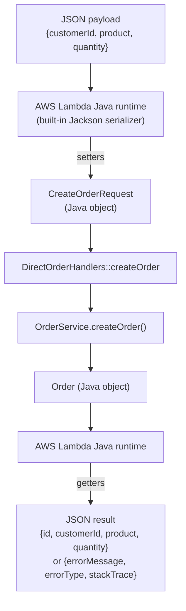
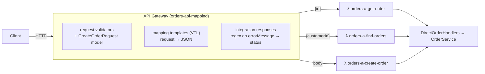
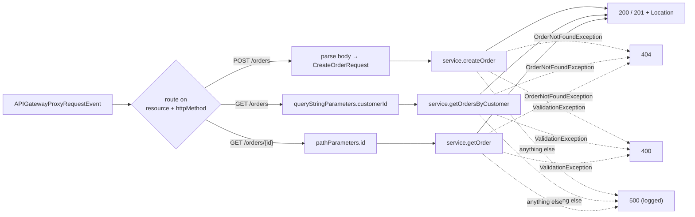
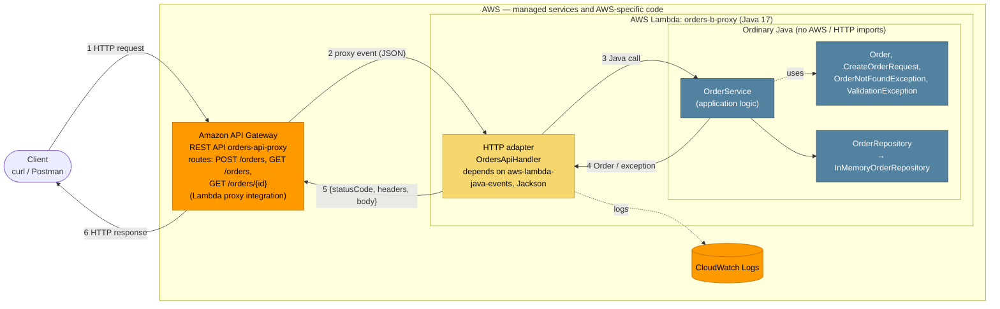

# Orders API — a serverless REST API with AWS Lambda and API Gateway

A small Order Management API in **Java 17 + Maven**. It is exposed through **Amazon API Gateway**
in two architectures that share the same plain-Java application logic:

* **A — mapping templates (non-proxy integration).** API Gateway extracts parameters, shapes the
  JSON sent to Lambda and maps errors to status codes. There is one Lambda per operation.
* **B — Lambda proxy integration.** API Gateway forwards the whole HTTP request to one Lambda. A
  thin HTTP adapter in Java handles routing and HTTP responses.

| Operation | Request | Success |
|---|---|---|
| Create an order | `POST /orders` | `201 Created` + `Location` |
| Retrieve an order | `GET /orders/{id}` | `200 OK` |
| Find a customer's orders | `GET /orders?customerId={customerId}` | `200 OK` |

---

## Contents

1. [Build and test](#1-build-and-test)
2. [Project structure](#2-project-structure)
3. [API design (contract)](#3-api-design-contract)
4. [Checkpoint 1 — plain Java](#4-checkpoint-1--plain-java)
5. [Part II — Lambda and JSON ↔ Java conversion](#5-part-ii--lambda-and-json--java-conversion)
6. [Architecture A — API Gateway mapping templates](#6-architecture-a--api-gateway-mapping-templates)
7. [Architecture B — Lambda proxy integration](#7-architecture-b--lambda-proxy-integration)
8. [Comparison of the two architectures](#8-comparison-of-the-two-architectures)
9. [Unexpected internal errors](#9-unexpected-internal-errors)
10. [Final architecture](#10-final-architecture)
11. [AI-assisted development — criticizing the agent](#11-ai-assisted-development--criticizing-the-agent)
12. [Demonstration checklist](#12-demonstration-checklist)

Other documents:

* [`docs/aws-setup.md`](docs/aws-setup.md) explains how to reproduce the AWS setup, either with SAM or step by step in the console.
* [`docs/examples.md`](docs/examples.md) has example requests and responses (curl).
* [`template.yaml`](template.yaml) is the infrastructure as code for both architectures, including every mapping template.
* [`events/`](events/) has example payloads: `direct-*.json` for invoking the Lambdas directly and `proxy-*.json` with API Gateway proxy events.

---

## 1. Build and test

Requirements: JDK 17 or newer, Maven 3.9+.

```bash
mvn test        # unit tests: no AWS account, no network, no server
mvn package     # target/orders-api-1.0.0.jar  (shaded JAR that is uploaded to Lambda)
```

Deploying is covered in [`docs/aws-setup.md`](docs/aws-setup.md). The short version is
`mvn package && sam deploy --guided`.

---

## 2. Project structure

```
.
├── pom.xml
├── template.yaml                     # SAM: both APIs, all Lambdas, mapping templates
├── events/                           # sample Lambda inputs (direct + proxy)
├── docs/
└── src/
    ├── main/java/edu/eci/tdse/orders/
    │   ├── domain/                   # ── ordinary Java, no AWS, no HTTP ──
    │   │   ├── Order.java
    │   │   ├── CreateOrderRequest.java
    │   │   ├── OrderService.java     # create / get / find by customer
    │   │   ├── OrderRepository.java  # storage port
    │   │   ├── InMemoryOrderRepository.java
    │   │   ├── OrdersApplication.java# wiring + seed data
    │   │   ├── OrderException.java   # base: carries a business error code
    │   │   ├── OrderNotFoundException.java
    │   │   └── ValidationException.java
    │   └── lambda/
    │       ├── direct/               # Architecture A handlers (POJO in / POJO out, no AWS libs)
    │       │   ├── DirectOrderHandlers.java
    │       │   ├── DirectInvocationException.java
    │       │   ├── OrderIdInput.java
    │       │   └── CustomerQueryInput.java
    │       └── proxy/                # Architecture B HTTP adapter (knows API Gateway + HTTP)
    │           ├── OrdersApiHandler.java
    │           └── ErrorResponse.java
    └── test/java/edu/eci/tdse/orders/
        ├── ArchitectureTest.java     # fails if domain/ imports AWS, Jackson, servlet, Spring…
        ├── domain/OrderServiceTest.java
        ├── lambda/direct/DirectOrderHandlersTest.java
        └── lambda/proxy/OrdersApiHandlerTest.java
```

---

## 3. API design (contract)

The contract was written before any code.

### Representations

```json
// Order
{ "id": "ORD-001", "customerId": "CUST-42", "product": "MacBook Air", "quantity": 1 }

// Error (every error response, whichever component produced it)
{ "error": "ORDER_NOT_FOUND", "message": "Order ORD-999 does not exist" }
```

`error` is a stable, machine-readable code that clients can branch on. `message` is a
human-readable explanation. The HTTP status is not repeated in the body because the status line
already carries it.

| `error` code | HTTP | Meaning |
|---|---|---|
| `VALIDATION_ERROR` | 400 | A required field or parameter is missing or breaks a business rule |
| `INVALID_REQUEST_BODY` | 400 | The body is not valid JSON or has wrong types (B) |
| `ORDER_NOT_FOUND` | 404 | No order has that id |
| `ROUTE_NOT_FOUND` | 404 | No such resource/method |
| `METHOD_NOT_ALLOWED` | 405 | The resource exists but not with that method (B, plus an `Allow` header) |
| `INTERNAL_ERROR` | 500 | Unexpected failure. The details are logged, never returned |

### Operations

| | `POST /orders` | `GET /orders/{id}` | `GET /orders?customerId=` |
|---|---|---|---|
| Path params | – | `id` (order id) | – |
| Query params | – | – | `customerId` (**required**) |
| Request body | `{"customerId","product","quantity"}` | – | – |
| Success | **201** + `Location: /orders/{newId}` + created `Order` | **200** + `Order` | **200** + `Order[]` (possibly `[]`) |
| Errors | 400 `VALIDATION_ERROR` / `INVALID_REQUEST_BODY`, 500 | 400 (blank id), 404 `ORDER_NOT_FOUND`, 500 | 400 (missing `customerId`), 500 |

Validation rules: `customerId` and `product` are required and must be non-blank, `quantity` is
a required integer ≥ 1. The `id` is always assigned by the server, so an `id` in the POST body is
ignored.

### Questions

**What are the resources in your API?**
There are two. The collection of orders is `/orders`, and each individual order is `/orders/{id}`.
A customer is not a resource in this API. It is only an attribute we filter on (see below).

**Why `/orders/{id}` to retrieve a particular order?**
In REST, a URL identifies a resource. The id is what makes one order distinct from the others, so
it belongs in the path, as a child of the collection it lives in. `GET` on that URL reads it,
`DELETE` on the same URL removes it, and `POST /orders` returns that URL in `Location`. The URL
is stable, can be cached and bookmarked, and contains no verbs (`/getOrder?id=` would be RPC style).

**Why is `customerId` a query parameter in the search operation?**
The search does not identify a new resource. It filters the `/orders` collection, and the result
is still "orders", just fewer of them. Query parameters are the conventional place for optional,
combinable filters (`?customerId=…&product=…&page=2`). A design like `/customers/{id}/orders`
would make sense only if customers were first-class resources of this API, and they are not.

**What should `POST /orders` return when an order is successfully created?**
`201 Created`, a `Location: /orders/{id}` header pointing at the new resource, and the created
order (including the server-generated `id`) in the body. The client then doesn't need a second
request to learn the id.

**What should the API return when an order does not exist?**
`404 Not Found` with `{"error":"ORDER_NOT_FOUND","message":"Order ORD-999 does not exist"}`.
This is different from a search that matches nothing. `GET /orders?customerId=CUST-NOBODY`
returns `200` and `[]`, because the collection exists and the filtered view is simply empty.

**What information should an error response contain?**
It needs a stable machine-readable code (`error`) and a human-readable `message`. It must not
contain stack traces, exception class names or other internal details. The format is the same
for every error, whether Java or API Gateway produced it. In a larger system I would also add a
request/correlation id (the Lambda `awsRequestId`) so a client report can be matched to the logs.

---

## 4. Checkpoint 1 — plain Java

`OrderService` exposes `createOrder(CreateOrderRequest)`, `getOrder(String)` and
`getOrdersByCustomer(String)`. It reports failures with `OrderNotFoundException` and
`ValidationException`, each of which carries a business code. There is no HTTP status anywhere
in it.

| Question | Answer |
|---|---|
| Can the functionality be tested without AWS? | **Yes.** `OrderServiceTest` covers a valid order, retrieving an existing order, a missing order, search by customer and invalid input. It needs only the JVM and JUnit. |
| Does it require a web server? | **No.** Nothing listens on a port. The methods are ordinary Java calls. |
| Does it require Spring Boot? | **No.** No framework at all. `ArchitectureTest` fails the build if `domain/` imports Spring, servlets, AWS or Jackson. |
| What does the generated JAR contain? | `mvn package` uses the Shade plugin. `target/orders-api-1.0.0.jar` (≈3.4 MB) contains our compiled classes and all runtime dependencies: `aws-lambda-java-core`, `aws-lambda-java-events` and Jackson. Lambda needs this single "uber JAR". `original-orders-api-1.0.0.jar` (≈20 KB) holds only our own classes. |
| Which parts currently know about HTTP? | **None of the application logic.** Only `lambda/proxy/OrdersApiHandler` (Architecture B) knows about HTTP methods, status codes and headers. In Architecture A, HTTP knowledge lives in the API Gateway configuration, not in Java. |

---

## 5. Part II — Lambda and JSON ↔ Java conversion

`DirectOrderHandlers::createOrder` was deployed as the function `orders-a-create-order` and
invoked directly with `events/direct-create-order.json` and `events/direct-create-order-2.json`.
Steps are in [`docs/aws-setup.md`](docs/aws-setup.md#part-ii--a-lambda-invoked-directly-no-api-gateway).

Note that `DirectOrderHandlers` does **not** implement `RequestHandler` and imports nothing from
AWS. It is a plain class with methods like `Order createOrder(CreateOrderRequest)`.

### How does the Lambda Java runtime convert JSON to Java objects and back?

1. **The handler string picks the method.** The value
   `edu.eci.tdse.orders.lambda.direct.DirectOrderHandlers::createOrder` tells the runtime which
   class to instantiate (it needs a public no-arg constructor, and the instance is reused while
   the execution environment stays warm) and which method to call. The class does not need to
   implement `RequestHandler`, because the runtime finds the method by reflection. An optional
   `Context` parameter can come second.
2. **Input.** The runtime reads the method's declared parameter type and deserializes the
   invocation payload into it, using the runtime's built-in serializer (the
   `aws-lambda-java-serialization` library, a shaded Jackson):
   * POJO: built with the no-arg constructor, then JSON properties are set through matching
     setters (`"customerId"` → `setCustomerId`).
   * Properties missing from the JSON stay `null` or default. This is why `quantity` is an
     `Integer`, so "missing" can be told apart from `0`.
   * Properties in the JSON with no matching setter are ignored.
   * `String`, `Integer`, `Map`, `List` and the AWS event classes
     (`APIGatewayProxyRequestEvent`…) are also supported. The event classes get special mapping
     rules.
   * If the handler takes `InputStream`/`OutputStream` (`RequestStreamHandler`), **no**
     conversion happens and you parse the bytes yourself.
3. **Output.** The return value is serialized to JSON through its **getters** (`getId()` → `"id"`).
   `void`/`null` produces `null`. This is why `Order` is a class with getters and not a record:
   records expose `id()` instead of `getId()`, and only recent versions of the runtime's
   serializer understand records.
4. **Exceptions.** An uncaught exception becomes a JSON error document
   `{"errorMessage": "...", "errorType": "<exception class>", "stackTrace": [...]}`, and the
   invocation is flagged as a *function error*. Architecture A depends on this, because API
   Gateway matches its regexes against `errorMessage`.

### Verification against the deployed Lambda

The explanation came from the LLM. Run these invocations, compare with the expected column, and
record what you actually observed:

| Input | Expected (from the explanation above) | Observed |
|---|---|---|
| `direct-create-order.json` | `{"id":"ORD-XXXXXXXX","customerId":"CUST-42","product":"MacBook Air","quantity":1}` | |
| `direct-create-order-2.json` | new id, `CUST-100`, `quantity: 3` | |
| `{"customerId":"CUST-42","product":"Mouse","quantity":1,"color":"red"}` | succeeds, `color` ignored | |
| `{"customerId":"CUST-42","product":"Mouse"}` | error, `errorMessage: "VALIDATION_ERROR: quantity is required"` (missing → `null`) | |
| `{"customerId":"CUST-42","product":"Mouse","quantity":"2"}` | succeeds, `"2"` coerced to `2` | |
| `direct-create-order-invalid.json` | `errorMessage: "VALIDATION_ERROR: quantity must be greater than 0"`, `errorType: ...DirectInvocationException` | |
| invoke `orders-a-get-order` with `direct-get-order-missing.json` | `errorMessage: "ORDER_NOT_FOUND: Order ORD-999 does not exist"` | |

### Checkpoint 2 — the actual flow



---

## 6. Architecture A — API Gateway mapping templates



### `GET /orders/{id}`

The request template extracts `{id}` from the path:

```velocity
{"id": "$util.escapeJavaScript($input.params('id'))"}
```

so `GET /orders/ORD-42` invokes `getOrder` with `{"id": "ORD-42"}`. The Java code never sees the
URL.

### `GET /orders?customerId=…`

`customerId` is declared as a required query parameter, and the request validator returns `400`
before Lambda is called if it is missing. The template:

```velocity
{"customerId": "$util.escapeJavaScript($input.params('customerId'))"}
```

### `POST /orders`

API Gateway validates the body against the `CreateOrderRequest` JSON-schema model, checking only
required fields and types. The body is then passed through (`$input.json('$')`). The default
integration response is changed to **201**, and a template sets the `Location` header:

```velocity
#set($context.responseOverride.header.Location = "/orders/$input.path('$.id')")
$input.json('$')
```

### HTTP semantics: how errors become status codes

The Java handler signals errors by throwing `DirectInvocationException` with the message
`"<CODE>: <text>"`. API Gateway matches **Lambda error regexes** against `errorMessage`:

| Regex | Status | Body built by the template |
|---|---|---|
| *(default)* | 200 / 201 | the Lambda result |
| `ORDER_NOT_FOUND:.*` | 404 | `{"error":"ORDER_NOT_FOUND","message":"Order ORD-999 does not exist"}` |
| `VALIDATION_ERROR:.*` | 400 | `{"error":"VALIDATION_ERROR","message":"quantity must be greater than 0"}` |
| `INTERNAL_ERROR:.*` | 500 | `{"error":"INTERNAL_ERROR","message":"Unexpected internal error"}` |

API Gateway's own errors (invalid body, missing parameter, unknown route) are given the same JSON
shape through **gateway responses**. The full configuration is in `template.yaml` (`MappedApi`)
and [`docs/aws-setup.md`](docs/aws-setup.md#part-iv--architecture-a-rest-api-with-mapping-templates).

### Checkpoint 3 — what API Gateway is responsible for in A

| Responsibility | Where it lives in A |
|---|---|
| Routing (method + path → function) | API Gateway: each method is wired to its own Lambda |
| Extracting path parameters | API Gateway mapping template (`$input.params('id')`) |
| Extracting query parameters | API Gateway mapping template + required-parameter declaration |
| Structural validation (required fields, types) | API Gateway request validator + model |
| Business validation (`quantity ≥ 1`, non-blank) | Java (`OrderService`) |
| Transforming requests | API Gateway (VTL builds the Lambda input) |
| Transforming responses | API Gateway (VTL builds the error body, adds `Location`) |
| Choosing status codes | API Gateway (default response = 200/201, regexes = 4xx/5xx) |
| Mapping errors | **Split.** Java decides the *code* (`ORDER_NOT_FOUND`), API Gateway turns it into a status and body |

**Advantages**

* The Java handlers are tiny. They contain no HTTP and no AWS imports, and each one is just a
  method call.
* Invalid requests are rejected *before* a Lambda runs, which saves invocations and cold starts.
* The API contract (parameters, models, status codes) is declared in one place that can be
  exported as OpenAPI/Swagger.
* Each operation is its own function, so it can have its own memory size, timeout, IAM
  permissions and metrics.

**Disadvantages**

* **The behaviour is split across two places, and they are coupled by strings.** The
  `"ORDER_NOT_FOUND: "` prefix in Java has to match a regex in API Gateway. If someone renames the
  code in Java, the compiler and the unit tests both pass, and the API starts answering **200**
  with an error body.
* **Failures that don't match a regex fall through to the default response.** That is a 200
  (or 201) containing `{"errorMessage": ...}`. A Lambda timeout or out-of-memory produces a
  message without our prefix, so it hits exactly this case.
* VTL is hard to read, debug and test, and none of it runs in `mvn test`. A typo shows up only
  after deployment.
* The amount of configuration grows with every operation × every status code.
* Lock-in: the HTTP behaviour exists only in API Gateway's proprietary configuration.
* In this workshop, each function has its own in-memory store, so **an order created through A's
  POST cannot be read through A's GET**. They are different JVMs. Only the seeded orders are
  visible to every function. (B has the same problem across cold starts and concurrent
  instances. Neither in-memory store is persistent.)

---

## 7. Architecture B — Lambda proxy integration

With proxy integration, API Gateway does no transformation. It wraps the full HTTP request in an
event, and the Lambda must return `{statusCode, headers, body}`.

### Where the information appears in the proxy event

Example: [`events/proxy-get-order.json`](events/proxy-get-order.json); also `proxy-find-orders.json` and `proxy-create-order.json`.

| Information | Field in the event (REST API, payload v1) | Example |
|---|---|---|
| HTTP method | `httpMethod` (also `requestContext.httpMethod`) | `"GET"` |
| Path | `path` (actual) / `resource` (template) | `"/orders/ORD-42"` / `"/orders/{id}"` |
| Path parameters | `pathParameters` | `{"id": "ORD-42"}` |
| Query parameters | `queryStringParameters` (+ `multiValueQueryStringParameters`) | `{"customerId": "CUST-42"}` |
| Headers | `headers` (+ `multiValueHeaders`) | `{"Content-Type": "application/json", ...}` |
| Request body | `body`: always a **string** (JSON not parsed), see `isBase64Encoded` | `"{\"customerId\":\"CUST-42\",...}"` |

When a field is absent it is `null`, not empty. For example, `queryStringParameters` is `null`
when there is no query string, and the handler handles that. Set `LOG_EVENTS=true` on the
function to print real events to CloudWatch.

### The HTTP adapter

`OrdersApiHandler` is the **only** class that knows about API Gateway and HTTP:



* The handler knows about the event, routing, path/query parameters, JSON parsing of the body,
  status codes, `Content-Type`, `Location` and `Allow` headers, and serializing the response.
* The application logic deals only with `Order`, `CreateOrderRequest`, customer ids and
  quantities, exactly as before. **No class in `domain/` changed** to support B.

`Location: /orders/{id}` is returned on 201. It is the standard way (RFC 9110) to tell the client
the URL of the resource it just created. A relative URL is used because the handler cannot know
the stage or custom domain the client called through.

All of B's behaviour is unit tested locally (`OrdersApiHandlerTest`, 16 tests). The tests build
events by hand and also load the saved `events/proxy-*.json`.

---

## 8. Comparison of the two architectures

| Question | A — API Gateway transformation | B — Proxy + Java adapter |
|---|---|---|
| **More API Gateway configuration?** | **A, by far.** Per method: a request template, a model/validator, method responses, one integration response (regex + template) per status, plus gateway responses. About 200 lines of `template.yaml`. | Per method: "Lambda proxy, on". About 15 lines. |
| **More Java infrastructure code?** | Very little. One POJO-in/POJO-out class, two input DTOs, one exception. No AWS dependency at all. | **B.** `OrdersApiHandler` (~200 lines) does routing, parsing, status mapping and headers, and depends on `aws-lambda-java-events` + Jackson. |
| **Easier to test locally?** | Java parts yes. The VTL templates, regexes and validators **cannot** be tested with `mvn test`. You have to deploy (or use the console's *Test* button). | **B.** The whole HTTP behaviour (status codes, headers, error bodies, malformed JSON) is covered by JUnit in milliseconds. |
| **Where are status codes defined?** | In API Gateway: the default integration response (200/201), the regexes (400/404/500) and gateway responses (validation). Java only decides the error *code*. | In Java, in one method (`statusFor`) plus `ok`/`created` in the adapter. API Gateway only produces a status for errors raised before Lambda runs (unknown route). |
| **3 → 30 operations?** | Configuration grows to roughly 30 × (template + responses × statuses). Every new status code has to be added to every method. Copy-paste errors become likely, and you get either 30 functions to deploy and monitor or a dispatch hack. | Each operation adds one route and one service call. A hand-written `switch` gets clumsy by then, so you would move to a small router table or a library (e.g. `aws-serverless-java-container`, Micronaut/Quarkus functions), or split into a few Lambdas by bounded context. |
| **Cleaner Java business logic?** | **Equal. `domain/` is identical in both.** A has the cleaner *handler* (no HTTP at all). | Equal. The HTTP concerns are contained in one adapter class. |
| **Easier for another developer to understand?** | Harder. To understand one request you read Java, a JSON-schema model, VTL and regex mappings, which are spread across the console or YAML. | Easier. The request path is readable top to bottom in one Java file, and a debugger can step through it. |
| **For a larger system?** | Worth it for a stable, public API owned by a platform team, or when gateway features matter (validation before invocation, direct AWS-service integrations without Lambda). | **My choice.** A proxy integration (or an HTTP API) with a thin adapter per bounded context. I would keep **structural validation optionally in the gateway** (or in an OpenAPI-driven validator) as defense in depth. HTTP semantics stay in versioned, tested code, and the domain stays pure. |

The deciding factor for me is **where errors are caught**. In A, a broken contract between Java
and the gateway (a renamed error code) is invisible until production and fails *silently* as a
200. In B the same mistake breaks a unit test.

---

## 9. Unexpected internal errors

| | What happens |
|---|---|
| **B** | Any exception that is not an `OrderException` is caught in `OrdersApiHandler`. The stack trace goes to CloudWatch, and the client gets `500 {"error":"INTERNAL_ERROR","message":"Unexpected internal error"}` with no internal details (tested). If the Lambda itself crashes or times out, API Gateway returns `502`/`504` `{"message": "Internal server error"}`. |
| **A** | Unexpected exceptions are wrapped as `INTERNAL_ERROR: …` and mapped to 500 by regex (tested on the Java side). A Lambda **timeout or out-of-memory** produces an `errorMessage` that matches no regex, so API Gateway returns the **default 200 response** with the raw error. This is a real weakness of A. A catch-all regex (`.+`) on 500 would avoid it, but it is easy to forget. |

---

## 10. Final architecture



Legend: **orange** marks AWS managed services, **yellow** marks AWS-specific Java (the adapter),
and **blue** marks ordinary Java that runs and is tested without AWS. Dependencies point inward:
the adapter depends on the domain, and the domain depends on nothing.

---

## 11. AI-assisted development — criticizing the agent

This project was built with an AI coding agent (Claude Code). The agent was asked to propose the
architecture before writing code. The non-trivial decisions it made are analyzed below.

> ✍️ **Note to self:** the factual parts below (decision, alternatives, what was implemented) are
> accurate to the code. The *"Do I agree?"* paragraphs are a draft assessment. Review and rewrite
> them in my own words before submitting.

### Decision 1 — one Lambda per operation in A, one Lambda for the whole API in B

* **Decision made by the agent:** Architecture A has three functions (`orders-a-create-order`,
  `-get-order`, `-find-orders`), each pointing at a different method of the same class.
  Architecture B has a single function.
* **Why do I think it proposed this?** In non-proxy integration each API Gateway method is wired
  to one function, and the mapping template produces exactly that function's input type. A single
  function would need an extra `"operation"` field and a dispatcher, which reintroduces routing
  into Java. With proxy integration the handler already receives the method and path, so one
  function is the natural fit.
* **Do I agree?** *(draft)* Mostly. It shows each style as it is normally used. But the agent did
  not mention one consequence until asked to analyze it: with in-memory storage, **POST through A
  creates orders that A's GET can never see**, because each function has its own JVM. For the
  workshop that is a useful demonstration that Lambda memory is not storage. In a real system it
  would force a shared database from day one.
* **Alternative:** a single Lambda for A with the operation name injected by each mapping template
  (`{"operation":"get","id":...}`), or DynamoDB behind both.
* **What I implemented and why:** the agent's proposal, with the limitation documented (§6). The
  demo of create-then-read uses Architecture B.

### Decision 2 — error codes in the domain, HTTP status mapping in the adapters

* **Decision made by the agent:** domain exceptions carry a business code (`ORDER_NOT_FOUND`,
  `VALIDATION_ERROR`) but no HTTP status. B maps exception type → status in `statusFor()`. A
  embeds the code as a message prefix (`"ORDER_NOT_FOUND: …"`) that API Gateway regexes match.
* **Why do I think it proposed this?** It keeps `domain/` free of HTTP. A status code is a
  transport concern, so the same service could sit behind a CLI or a queue. The prefix exists
  because, in non-proxy integration, `errorMessage` is the *only* thing API Gateway can select on.
* **Do I agree?** *(draft)* Yes for the domain/adapter split. The message-prefix contract in A
  is fragile, though: it is a string protocol between Java and VTL that no compiler checks. The
  agent did add unit tests that pin the exact messages (`DirectOrderHandlersTest`), which reduces
  the risk on the Java side, but the regex side still cannot be tested locally.
* **Alternative:** put `httpStatus` directly in the domain exceptions (simpler, but it leaks HTTP
  into the domain). Or, in A, return a result envelope `{status, body}` instead of throwing and
  map it with a template. That removes the regexes but makes the Java handlers HTTP-aware, at
  which point you are halfway to a proxy integration.
* **What I implemented and why:** the agent's proposal, plus `ArchitectureTest` to enforce that
  `domain/` stays free of AWS/HTTP imports.

### Decision 3 — where validation lives

* **Decision made by the agent:** business rules (`customerId`/`product` non-blank, `quantity ≥ 1`)
  are validated in `OrderService`. Syntactic problems (malformed JSON, `quantity: "many"`,
  `quantity: 1.5`) are handled by the adapter in B (`INVALID_REQUEST_BODY`). In A, API Gateway's
  model checks only required fields and types.
* **Why do I think it proposed this?** If business rules lived only in API Gateway (e.g. `minimum: 1`
  in the JSON schema), B and any future entry point would have to duplicate them, and the plain
  Java tests would not cover them. Keeping them in the service means every architecture enforces
  them.
* **Do I agree?** *(draft)* Yes. One detail worth noticing is that the agent explicitly disabled
  Jackson's `ACCEPT_FLOAT_AS_INT`. Without that, `"quantity": 1.9` would silently become `1`. That
  is a good catch, the kind of default that is easy to miss.
* **Alternative:** Bean Validation (`jakarta.validation` annotations) on `CreateOrderRequest`. It
  is declarative and standard, but it adds a dependency to the domain for three rules.
* **What I implemented and why:** the agent's proposal. The duplication in A (the gateway checks
  types, Java checks rules) is deliberate defense in depth.

### Decision 4 — server-generated random ids instead of a sequence

* **Decision made by the agent:** ids are `ORD-` + 8 random hex chars (from a UUID), not
  `ORD-001, ORD-002…`. The generator is injectable for tests.
* **Why do I think it proposed this?** A counter in memory restarts at 1 on every cold start and
  in every concurrent execution environment, so it would hand out duplicate ids.
* **Do I agree?** *(draft)* Yes for this setting. Eight hex characters can collide at large scale.
  A real system would use the full UUID, or let the database generate the key.
* **What I implemented:** the agent's proposal.

---

## 12. Demonstration checklist

Video: *(add link)*

1. `mvn test`: 38 tests, all green.
2. `mvn package`: show `target/orders-api-1.0.0.jar`.
3. Invoke a Lambda directly: console *Test* with `events/direct-create-order.json` (or `aws lambda invoke`).
4. Call the deployed API (commands in [`docs/examples.md`](docs/examples.md)):
   successful POST (201 + `Location`), successful GET (200), 404 (`ORD-999`), 400 (`quantity: 0`).
5. Show the architecture diagram (§10).
